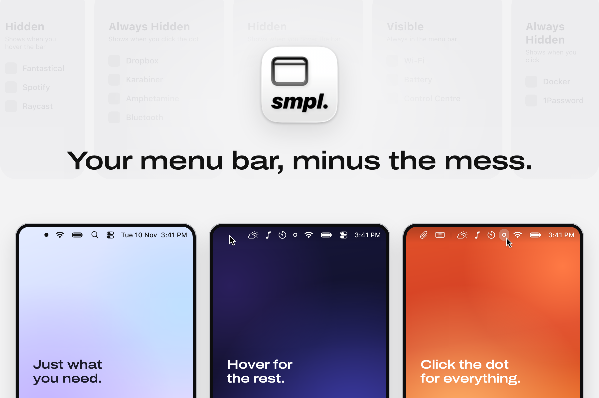

# [smpl.menubar](https://smpl-menubar.tnitish.com)

A tiny menu bar app for macOS that hides the icons you don't need.

It felt like most menu bar apps did too much, so this exists now. Pick which apps stay visible, which ones hide, and you're done. There are no themes, profiles or settings to tweak.

## How it works

smpl.menubar adds a small dot to your menu bar. Everything left of it is tucked away.

- **Visible** apps stay in the menu bar like normal.
- **Hidden** apps show up when you rest your pointer on the menu bar, then go away a couple of seconds after you leave.
- **Always Hidden** apps only show up when you click the dot. Click it again to put them back.

To sort your apps, open smpl.menubar again from Spotlight or right-click the dot and choose **Arrange…**, then drag apps between the three sections.

Under the hood it uses the same switch as **System Settings → Menu Bar**, so hidden apps really are hidden rather than pushed off-screen. Quitting smpl.menubar brings every app back.

## Install

Needs **macOS 27** or later.

For direct installation, download the **DMG** from the
[latest release](https://github.com/TechSupportz/smpl-menubar/releases/latest),
open it, and drag **smpl.menubar** to **Applications**.

Or install with Homebrew:

```sh
brew install --cask TechSupportz/tap/smpl-menubar
open /Applications/smpl.menubar.app
```

The app must be in `/Applications` for macOS 27 to show its menu bar icon.
Update with `brew upgrade --cask smpl-menubar`.

You can also download the signed and notarized app from [GitHub Releases](https://github.com/TechSupportz/smpl-menubar/releases/latest).

### Build from source

With Xcode installed:

```sh
git clone https://github.com/TechSupportz/smpl-menubar.git
cd smpl-menubar
./build.sh --run
```

### Full Disk Access

The first time it opens, smpl.menubar asks for **Full Disk Access**. The menu bar switches live in a protected file, and this is the only way to change them. It only touches the menu bar's own settings, and it keeps a copy of the original list in `~/Library/Application Support/smpl-menubar` in case you ever want it back.

## Privacy

There are no accounts, analytics or network requests. Everything stays on your Mac.

## License

MIT
